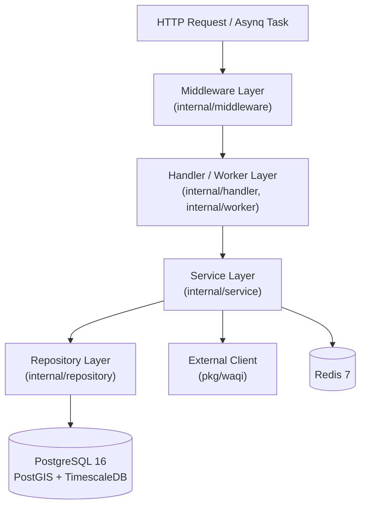

# AQI Health Monitor — Backend

## Overview

The `backend/` directory contains the Go backend for **AQI Health Monitor**, implemented as a **Modular Monolith**. A single Go module (`aqi-health-monitor/backend`) compiles into two distinct executables:

1. **`cmd/api`**: Synchronous HTTP REST API server handling authenticated user state, health profiles, alert thresholds, and geospatial user locations.
2. **`cmd/worker`**: Background worker and CLI runner responsible for discovering WAQI monitoring stations, fetching hourly AQI readings into TimescaleDB, and caching current station telemetry in Redis.

## Technology Stack

All dependencies below are verified directly from [`go.mod`](./go.mod):

| Category | Package / Tool | Version | Role |
| :--- | :--- | :--- | :--- |
| **Language** | Go | `1.26.4` | Core language and standard library HTTP server (`net/http`) |
| **Database Driver** | `github.com/jackc/pgx/v5` | `v5.11.0` | PostgreSQL driver (registered via `pgx/v5/stdlib`) |
| **SQL Toolkit** | `github.com/jmoiron/sqlx` | `v1.4.0` | Struct scanning, named queries, and transaction management |
| **Cache Client** | `github.com/redis/go-redis/v9` | `v9.22.0` | Redis client for station reading cache (`aqi:current:{station_id}`) |
| **Task Queue** | `github.com/hibiken/asynq` | `v0.26.0` | Redis-backed distributed task queue for background jobs |
| **JWT / JWKS** | `github.com/lestrrat-go/jwx/v2` | `v2.1.7` | OIDC JWKS key fetching, caching, and JWT signature/claim verification |
| **Configuration** | `github.com/joho/godotenv` | `v1.5.1` | Loads environment variables from `.env` files during local development |

> **Architecture Note**: Although early system architecture notes in [`../docs/08-SA.md`](../docs/08-SA.md) mentioned the Gin framework and `zerolog`/`zap`, the actual implementation uses Go's standard `net/http` (`http.NewServeMux`) and standard library `log` / `log/slog`.

## Backend Architecture

The codebase follows a strict layered architecture:



- **Handlers (`internal/handler`)**: Decode JSON payloads, perform structural and domain-range validation, extract verified JWT claims from `context.Context`, call services, and serialize standard JSON responses or error envelopes.
- **Services (`internal/service`)**: Enforce business rules (such as the 18-combination threshold matrix and cross-table ACID transactions) and orchestrate repositories and external clients.
- **Repositories (`internal/repository`)**: Execute parameterized SQL queries, PostGIS spatial conversions (`ST_MakePoint`, `ST_SetSRID`, `ST_X`, `ST_Y`), and atomic `ON CONFLICT` upserts.

## Directory Structure

```text
backend/
├── cmd/
│   ├── api/
│   │   └── main.go                         # HTTP API server entrypoint
│   └── worker/
│       └── main.go                         # Asynq worker & CLI task entrypoint (-task flag)
├── internal/
│   ├── auth/
│   │   ├── claims.go                       # Claims struct (Sub, Email, Name) & context helpers
│   │   ├── jwks_client.go                  # Keycloak JWKS fetcher with 15-minute in-memory cache
│   │   └── token_verifier.go               # JWT signature, issuer, expiration, and subject verifier
│   ├── config/
│   │   └── config.go                       # Environment variable loader with fallbacks
│   ├── database/
│   │   ├── postresql.go                    # sqlx + pgx connection pool setup (maxOpen=10, maxIdle=5)
│   │   └── redis.go                        # go-redis client initialization & 5s ping check
│   ├── handler/
│   │   ├── user_handler.go                 # GET /api/v1/me handler [Implemented]
│   │   ├── health_profile_handler.go       # POST /api/v1/health-profile handler [Implemented]
│   │   ├── location_handler.go             # POST /api/v1/locations handler [Implemented]
│   │   ├── aqi_handler.go                  # Package stub [Not Implemented]
│   │   ├── auth_handler.go                 # Package stub [Not Implemented]
│   │   └── push_handler.go                 # Package stub [Not Implemented]
│   ├── middleware/
│   │   └── auth_middleware.go              # Bearer token extraction & verification middleware
│   ├── models/
│   │   ├── user.go                         # User entity [Implemented]
│   │   ├── health_profile.go               # HealthProfile entity [Implemented]
│   │   ├── alert_threshold.go              # AlertThreshold entity [Implemented]
│   │   ├── user_location.go                # UserLocation entity [Implemented]
│   │   ├── station.go                      # Station entity [Implemented]
│   │   ├── aqi_reading.go                  # AQIReading hypertable entity [Implemented]
│   │   ├── alert_log.go                    # Package stub [Not Implemented]
│   │   └── push_subscription.go            # Package stub [Not Implemented]
│   ├── repository/
│   │   ├── user_repo.go                    # FindByKeycloakID, Create [Implemented]
│   │   ├── health_profile_repo.go          # FindByUserID, UpsertByUserID [Implemented]
│   │   ├── alert_threshold_repo.go         # FindByUserID, UpsertByUserID [Implemented]
│   │   ├── location_repo.go                # FindAllByUserID, UpsertByUserAndLabel [Implemented]
│   │   ├── station_repo.go                 # UpsertByWAQIID, ListActive [Implemented]
│   │   ├── aqi_reading_repo.go             # Insert reading + update station last_synced_at in tx [Implemented]
│   │   ├── alert_log_repo.go               # Package stub [Not Implemented]
│   │   └── push_subscription_repo.go       # Package stub [Not Implemented]
│   ├── service/
│   │   ├── user_sync_service.go            # FindOrCreate user & aggregate GetUserState [Implemented]
│   │   ├── health_profile_service.go       # 18-combo threshold matrix & transactional upsert [Implemented]
│   │   ├── health_profile_service_test.go  # Unit test for all 18 matrix combinations [Implemented]
│   │   ├── location_service.go             # User sync + atomic location upsert [Implemented]
│   │   ├── aqi_service.go                  # SyncStations, FetchReadings, Redis cache writer [Implemented]
│   │   ├── alert_service.go                # Package stub [Not Implemented]
│   │   └── notification_service.go         # Package stub [Not Implemented]
│   └── worker/
│       ├── sync_stations_task.go           # Asynq handler for "sync_stations" [Implemented]
│       ├── fetch_readings_task.go          # Asynq handler for "fetch_readings" [Implemented]
│       └── send_alert_task.go              # Package stub [Not Implemented]
├── migrations/                             # 12 SQL migration pairs (000001 to 000012, .up.sql / .down.sql)
├── pkg/waqi/
│   └── client.go                           # HTTP client for WAQI /map/bounds/ and /feed/@id/
├── Dockerfile                              # Multi-stage Dockerfile (targets: api, worker)
└── go.mod                                  # Module dependencies
```

## Core Modules and Responsibilities

1. **Authentication & Identity Sync (`internal/auth`, `internal/middleware`, `internal/service/user_sync_service.go`)**:
   - Verifies Keycloak-issued Bearer tokens against `{KEYCLOAK_ISSUER}/protocol/openid-connect/certs`.
   - Synchronizes the external `sub` claim to an internal `users` row (`keycloak_id`) idempotently on first API access.
2. **Health Profile & Alert Thresholds (`internal/service/health_profile_service.go`)**:
   - Maps `(condition_type, age_group, sensitivity_level)` to a default AQI threshold (`60` to `150`) via an explicit 18-entry lookup table matching [`../docs/02-BUSINESS-RULES.md`](../docs/02-BUSINESS-RULES.md).
   - Allows optional `custom_threshold_aqi` overrides (`[50, 500]`; values in `[0, 49]` are rejected with HTTP `422 THRESHOLD_TOO_LOW` to prevent alert fatigue).
   - Updates `health_profiles` and `alert_thresholds` atomically inside a single PostgreSQL transaction.
3. **Geospatial User Locations (`internal/service/location_service.go`, `internal/repository/location_repo.go`)**:
   - Stores up to one location per `(user_id, label)` pair (`current` or `home`) using PostGIS `GEOGRAPHY(Point, 4326)` and atomic `ON CONFLICT (user_id, label) DO UPDATE`.
4. **WAQI Telemetry Ingestion (`pkg/waqi`, `internal/service/aqi_service.go`, `internal/worker`)**:
   - `SyncStations`: Queries WAQI `/map/bounds/` for Hanoi (`20.85, 105.70` to `21.20, 106.00`) and Ho Chi Minh City (`10.65, 106.55` to `10.95, 106.85`), upserting discovered stations by `waqi_station_id`.
   - `FetchReadings`: Iterates over active stations, fetches `/feed/@{waqi_station_id}/`, skips entries missing a valid AQI value with a warning log, inserts readings idempotently (`ON CONFLICT (station_id, time) DO NOTHING`) while updating `stations.last_synced_at` in the same transaction, and writes `aqi:current:{station_id}` to Redis with a 20-minute TTL.

## API Organization

All implemented endpoints are mounted under `/api/v1` in [`cmd/api/main.go`](./cmd/api/main.go) and require an `Authorization: Bearer <access_token>` header.

For full DTO schemas, field rules, and planned endpoints (such as `GET /api/v1/aqi/current`), see the complete specification in [`../docs/09-API_CONTRACT.md`](../docs/09-API_CONTRACT.md).

### Implemented Endpoints Summary

| Method | Path | Description | Success Status | Error Codes |
| :--- | :--- | :--- | :--- | :--- |
| `GET` | `/api/v1/me` | Synchronize user from JWT and return aggregated user state (`user`, `health_profile`, `alert_threshold`, `locations`). | `200 OK` | `401 UNAUTHORIZED`, `500 INTERNAL_ERROR` |
| `POST` | `/api/v1/health-profile` | Create or update health profile and recalculate/override `alert_threshold` in one transaction. | `200 OK` | `400 VALIDATION_ERROR`, `401 UNAUTHORIZED`, `422 THRESHOLD_TOO_LOW`, `500 INTERNAL_ERROR` |
| `POST` | `/api/v1/locations` | Create or update user location coordinates for label `current` or `home`. | `200 OK` | `400 VALIDATION_ERROR`, `401 UNAUTHORIZED`, `500 INTERNAL_ERROR` |

### Example Requests and Responses

#### 1. `POST /api/v1/health-profile`

```bash
curl -X POST http://localhost:8000/api/v1/health-profile \
  -H "Authorization: Bearer <KEYCLOAK_ACCESS_TOKEN>" \
  -H "Content-Type: application/json" \
  -d '{
    "condition_type": "asthma",
    "age_group": "adult",
    "sensitivity_level": "high",
    "custom_threshold_aqi": null
  }'
```

Response (`200 OK`):

```json
{
  "id": "b3f1c2d4-5678-4e9a-8b12-34567890abcd",
  "condition_type": "asthma",
  "age_group": "adult",
  "sensitivity_level": "high",
  "created_at": "2026-09-10T08:00:00Z",
  "updated_at": "2026-09-10T08:00:00Z",
  "alert_threshold": {
    "id": "d9e8f7a6-1234-4c5b-9d8e-76543210fedc",
    "threshold_aqi": 80,
    "is_custom": false,
    "updated_at": "2026-09-10T08:00:00Z"
  }
}
```

#### 2. `POST /api/v1/locations`

```bash
curl -X POST http://localhost:8000/api/v1/locations \
  -H "Authorization: Bearer <KEYCLOAK_ACCESS_TOKEN>" \
  -H "Content-Type: application/json" \
  -d '{
    "label": "current",
    "latitude": 21.0285,
    "longitude": 105.8542,
    "city": "hanoi"
  }'
```

#### 3. Standard Error Format

```json
{
  "error": {
    "code": "THRESHOLD_TOO_LOW",
    "message": "Ngưỡng cảnh báo không được dưới 50 (AQI dưới mức 'Trung bình' sẽ gây cảnh báo liên tục).",
    "details": [
      {
        "field": "custom_threshold_aqi",
        "reason": "min=50"
      }
    ]
  }
}
```

## Database and Data Models

The PostgreSQL database requires three extensions enabled in migration `000001`: `pgcrypto`, `postgis`, and `timescaledb`. Detailed entity-relationship diagrams and column specifications are documented in [`../docs/07-DATABASE_DESIGN.md`](../docs/07-DATABASE_DESIGN.md).

| Migration | Table / Change | Primary Key / Constraints | Go Repository Status |
| :--- | :--- | :--- | :--- |
| `000001` | Enable `pgcrypto`, `postgis`, `timescaledb` | — | — |
| `000002` | `users` | `id` (UUID), `UNIQUE (keycloak_id)` | Implemented (`user_repo.go`) |
| `000003` | `health_profiles` + enums | `id` (UUID), `UNIQUE (user_id)` FK → `users` | Implemented (`health_profile_repo.go`) |
| `000004` | `alert_thresholds` | `id` (UUID), `CHECK (threshold_aqi BETWEEN 0 AND 500)` | Implemented (`alert_threshold_repo.go`) |
| `000005`, `000012` | `user_locations` | `id` (UUID), `GEOGRAPHY(Point, 4326)`, `UNIQUE (user_id, label)` | Implemented (`location_repo.go`) |
| `000006` | `stations` | `id` (UUID), `UNIQUE (waqi_station_id)`, `GEOGRAPHY(Point, 4326)` | Implemented (`station_repo.go`) |
| `000007` | `aqi_readings` | Hypertable on `time`, PK `(station_id, time)`, compress > 30d | Implemented (`aqi_reading_repo.go`) |
| `000008`, `000011` | `push_subscriptions` | `id` (UUID), `UNIQUE (endpoint)`, `is_active` | Schema migrated; Go repo is stub |
| `000009`, `000010` | `alerts_log` + enums | `id` (UUID), FK `user_id`, `station_id`, `location_id` | Schema migrated; Go repo is stub |

## Authentication and Authorization

- **Token Verification**: `internal/auth/token_verifier.go` validates the JWT signature against Keycloak's JWKS endpoint (`{KEYCLOAK_ISSUER}/protocol/openid-connect/certs`), verifies the `iss` claim against `KEYCLOAK_ISSUER`, checks token expiration (`exp`), and requires a non-empty `sub` claim.
- **JWKS Caching**: `internal/auth/jwks_client.go` caches the parsed `jwk.Set` in memory for `15 minutes` (`jwksCacheTTL`) with a `10-second` HTTP timeout.
- **Data Isolation**: User-scoped handlers never accept `user_id` from request parameters or payloads; the internal `user_id` is always resolved from the authenticated `claims.Sub` (`keycloak_id`).

## Environment Variables

Defined in [`internal/config/config.go`](./internal/config/config.go):

| Variable | Default in `config.go` | Required | Description |
| :--- | :--- | :--- | :--- |
| `APP_PORT` | `8000` | No | TCP port for `cmd/api` HTTP server |
| `DB_HOST` | `localhost` | No | PostgreSQL hostname |
| `DB_PORT` | `5432` | No | PostgreSQL port |
| `DB_USER` | `admin` | Yes | PostgreSQL username |
| `DB_PASSWORD` | `admin` | Yes | PostgreSQL password |
| `DB_NAME` | `aqi` | Yes | PostgreSQL database name |
| `KEYCLOAK_ISSUER` | `http://localhost:8080/realms/aqi-monitor` | Yes (for API) | Expected JWT `iss` claim and base URL for JWKS discovery |
| `REDIS_ADDR` | `<REDIS_HOST>:<REDIS_PORT>` (`localhost:6379`) | No | Redis `host:port` used by `cmd/worker` (cache & Asynq) |
| `REDIS_HOST` | `localhost` | No | Fallback Redis host when `REDIS_ADDR` is unset |
| `REDIS_PORT` | `6379` | No | Fallback Redis port when `REDIS_ADDR` is unset |
| `WAQI_API_TOKEN` | `""` (empty) | Yes (for Worker) | Authentication token for WAQI API requests |
| `WAQI_BASE_URL` | `https://api.waqi.info` | No | Base URL for WAQI API (can be overridden for local fixture testing) |

## Installation and Local Development

1. Navigate to the `backend/` directory and download Go module dependencies:

```bash
cd backend
go mod download
```

2. Ensure PostgreSQL, Redis, and Keycloak are running (see [Root README](../README.md#2-start-infrastructure-services)) and `.env` is configured in the repository root.

3. Run the API server:

```bash
go run ./cmd/api
```

4. Run the Worker / CLI tasks:

```bash
# Run station discovery once (Hanoi & Ho Chi Minh City bounding boxes)
go run ./cmd/worker -task=sync_stations

# Run AQI reading ingestion once for all active stations
go run ./cmd/worker -task=fetch_readings

# Start the continuous Asynq worker server (Concurrency: 4)
go run ./cmd/worker -task=serve
```

## Database Setup and Migrations

The backend does not automatically run migrations on startup. Apply the 12 migration files in [`./migrations/`](./migrations/) before running `cmd/api` or `cmd/worker`.

### Option A: Using `golang-migrate` CLI

```bash
migrate -path ./migrations -database "postgres://<DB_USER>:<DB_PASSWORD>@localhost:5432/<DB_NAME>?sslmode=disable" up
```

### Option B: Using `docker exec` and `psql`

If `aqi-postgres` is running via Docker Compose, you can apply all `.up.sql` migrations in order from a bash/PowerShell terminal:

```bash
for f in migrations/*.up.sql; do
  docker exec -i aqi-postgres psql -U "$DB_USER" -d "$DB_NAME" < "$f"
done
```

## Testing

Run unit tests and static analysis from the `backend/` directory:

```bash
go test -v ./...
go vet ./...
```

- [`internal/service/health_profile_service_test.go`](./internal/service/health_profile_service_test.go) verifies `TestDefaultThresholdMatrix` across all 18 valid `(condition_type, age_group, sensitivity_level)` combinations and asserts error handling on unknown inputs.

## Build and Production Execution

### Compile Binaries Locally

```bash
cd backend
go build -o bin/api ./cmd/api
go build -o bin/worker ./cmd/worker
```

### Multi-Stage Docker Build

[`./Dockerfile`](./Dockerfile) defines a multi-stage build (`golang:1.26-alpine` builder → `alpine:3.20` runtime) with two distinct targets (`api` and `worker`):

```bash
# Build API image
docker build --target api -t aqi-backend-api:local .

# Build Worker image
docker build --target worker -t aqi-backend-worker:local .
```
